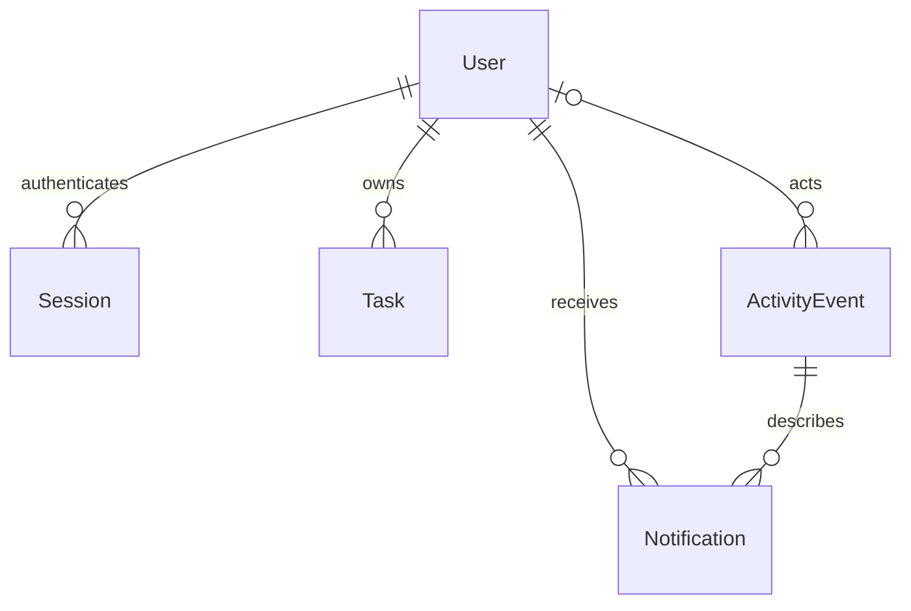

*This project has been created as part of the 42 curriculum by mahajj-h, jboustan.*

# Taskboard

One public task board: guests browse/search, members manage their own tasks,
and administrators manage tasks, users and roles. The entire demonstration runs
on one computer using separate browser sessions. No hosted service is required.

**Transcendence2 is staging. No push to the separate final history repository is
authorized yet.** Read [PUSH-MAP](docs/delivery/PUSH-MAP.md) before delivery.

## Instructions

Install Node.js 24, npm, Docker with Compose v2 and use a free local HTTPS port.
Local native builds may require Python, make and a C++ compiler; Docker includes
these. Package versions and container-image digests are pinned.

```sh
npm ci
./scripts/setup.sh
docker compose up --build -d --force-recreate
./scripts/verify-tls.sh
```

Open **https://localhost/en/tasks**. Setup creates a private, Git-ignored `.env`
with random administrator credentials and API key, and refuses to overwrite an
existing file. Read credentials privately from that file; scripts never print
them. Register demonstration members in the interface. The seeded API member
has no interactive password. Existing accounts are never reset or resurrected.

Startup migrates/seeds a fresh database automatically. The app runs as non-root;
only Caddy publishes a loopback HTTPS port. Database and certificate volumes
survive container recreation. `docker compose down` stops the app; adding `-v`
deletes its volumes and is not a normal restart.

Import the **public** `local-certs/root.crt` copied by the verifier into trusted
certificate authorities before normal browser use. Chrome/Edge use their
platform settings; Firefox may need a separate Authorities import. Reload
localhost without a certificate warning. Never distribute Caddy's private CA key.
The TLS script separately verifies the real chain, hostname and readiness.

For another port, before setup use
`./scripts/setup.sh --env-file .env --port 8443`. With an existing environment,
edit HTTPS_PORT and APP_ORIGIN consistently. In a managed cloud requiring its
provided proxy CA for networked builds:

```sh
COMPOSE_FILE=compose.yaml:compose.cloud.yaml docker compose up --build -d --force-recreate
```

CODEX_PROXY_CERT points to that provided public certificate. BuildKit mounts it
only during networked commands; it is not copied into app layers. A VFS Docker
driver can consume substantial cache space; reclaim unused builder cache when
needed while preserving application data/certificate volumes.

## Features

- Public SSR task text, combined text/status/priority/owner search, four stable
  sorts and 25-row pagination; useful content/filter links without JavaScript.
- Registration/login/logout, private profile/password changes, current-role
  permissions, own/admin task controls and stale-edit/delete conflict recovery.
- Admin user search, name/role changes and cascade-confirmed deletion, with
  immediate revocation and a concurrency-safe final-administrator guard.
- Five secured API operations, persistent quotas, OpenAPI and executable examples.
- JSON/CSV import/export: at most 200 rows/256 KiB, prevalidated all-or-nothing
  imports owned by the importer; export includes every filtered match.
- Twelve shared components, remembered light/dark modes, complete en/fr/ar,
  Arabic RTL, keyboard controls and responsive layouts.
- Transactional domain notifications and unread controls; personal seven-day
  UTC action totals, previous-period deltas, trend chart and accessible table.

Task titles, descriptions and display names are public. Emails, hashes, sessions
and admin data are private. Use demonstration content. Localized Privacy/Terms
pages explain the instance. Ordinary refresh shows other users' changes; no
real-time module is claimed. CSV formulas are apostrophe-prefixed for spreadsheet
safety; JSON preserves original text. Imports explicitly append duplicates.

## Technical choices and schema

Node 24 and Next.js App Router provide React and backend routes in one app.
TypeScript shares public DTOs. Tailwind 4 and semantic tokens style our original
components. Prisma supplies typed queries/migrations over one SQLite file; Caddy
provides HTTPS. No game server, broker, OAuth or runtime AI service is involved.



User stores unique normalized email and MEMBER/ADMIN role. Task stores content,
owner, version and timestamps. Session stores token hashes and expiry.
RateLimitBucket persists hashed-scope quotas. ActivityEvent keeps safe action
metadata and survives task deletion; actor references become null after account
deletion. Notification is unique per recipient/event and stores readAt. Foreign
keys cascade deleted accounts' sessions/tasks/recipient notifications.

Browser/API/import writes share the same task service. Current roles and version
predicates are checked inside short transactions. SQLite WAL, busy timeout and
bounded retry protect simultaneous actions; stale versions return 409.
Events and notifications commit atomically with their domain mutations.

Passwords use Argon2id (19 MiB, two iterations, parallelism one). Seven-day
sessions store SHA-256 token hashes; cookies are Secure, HttpOnly, SameSite=Lax
and host-scoped. Password changes revoke sessions. Browser mutations require
the configured Origin and bounded input. External keys have member permissions,
a shared 60/minute quota and separate invalid-key limit, without permissive CORS.
Credentials remain in ignored local files and never enter client bundles.

## Modules and points

| Selected module | Points |
| --- | ---: |
| Frontend/backend frameworks | 2 |
| Advanced permissions | 2 |
| Secured public API | 2 |
| ORM | 1 |
| Advanced search | 1 |
| Custom design system | 1 |
| Three languages | 1 |
| RTL | 1 |
| Additional browsers | 1 |
| SSR | 1 |
| Import/export | 1 |
| **Core target** | **14** |
| Domain notifications buffer | 1 |
| Personal activity analytics buffer | 1 |
| **Selected target** | **16** |

Themes are included in the design system and have no separate points. Mandatory
requirements remain a separate gate. The [module matrix](docs/requirements/module-matrix.md)
and [observed evidence](docs/evaluation/evidence.md) map implementation/tests and
limitations. Point values are the selected scope, not an official assessment.

## Verification

```sh
npm run db:migrate
npm run db:seed
npm test
npm run typecheck
npm run lint
npm run build
npm run audit:source
npm run smoke:auth
npm run smoke:tasks
./docs/api/examples.sh
npx playwright install --with-deps chrome firefox msedge
npm run verify
```

`verify` runs types, lint, real-database tests, build, artifact audit and actual
Chrome/Firefox/Edge suites. [OpenAPI and examples](docs/api/README.md) document
the external API; [auth](docs/api/auth.md) and [tasks](docs/api/tasks.md) cover
internal frontend contracts. Recorded versions are in the
[browser matrix](docs/evaluation/browser-matrix.md).

Browser tests use separate `.env.e2e`, taskboard-e2e-mahdi/8443 and independent
data/certificate volumes. Override TASKBOARD_E2E_PROJECT and TASKBOARD_E2E_PORT
for another checkout; Joseph's suggested port is 9443. Reset requires the test
project/port/database guard and verified Compose label. Normal volumes are never
reset. Browser automation explicitly allows the local CA; setup separately
verifies real CA/hostname TLS. Manual trusted-browser checks use imported CA
without a bypass. Non-root hosts may extract official branded browsers locally
and supply TASKBOARD_CHROME_EXECUTABLE/TASKBOARD_EDGE_EXECUTABLE.

`npm run rehearse` clones the exact committed branch, performs npm ci, private
setup, migrations/seed, checks/build, and isolated Chrome flows at port 9443.
TASKBOARD_E2E_IMAGE can reuse an image built from the same application source;
otherwise the test app builds normally. Ignored logs identify the exact revision.

## Team, management and individual contributions

Mahdi (`mahajj-h`, MahdiHajjHassan) directs scope, implementation and staging.
Joseph (`jboustan`, josephboustany) is the second team member. Both 42 logins are
owner-confirmed. The original split assigned Mahdi infrastructure/security/
writes/admin/API/transfers/events and Joseph UI/query/localization/browser/
activity work.

The owner then requested every package be completed now with Codex in staging
for Claude to reuse. **Current source provenance is Mahdi/Codex; a Joseph batch
label does not make that source Joseph-authored.** Joseph's actual later review,
adaptation, understanding and commits are recorded only when they happen.
Pushing unchanged commits preserves their original author; no identity/signature
or contribution is fabricated.

The [technical plan](docs/superpowers/plans/2026-10-26-taskboard.md),
[contribution schedule](docs/superpowers/plans/2026-10-26-team-contributions.md),
[delivery map](docs/delivery/PUSH-MAP.md), immutable batch manifests and
[Mahdi](docs/team/contributions/mahdi.md)/[Joseph](docs/team/contributions/joseph.md)
records separate plans, source commits, automated checks, human review and
delivery. Final-history publishing remains unauthorized.

## Resources and AI use

- Original [subject](docs/reference/en.subject.pdf), v21.1, and
  [evaluation sheet](docs/reference/EVALUATION-SHEET.pdf), unchanged.
- [Node](https://nodejs.org/docs/latest-v24.x/api/), [Next](https://nextjs.org/docs),
  [React](https://react.dev/), [Prisma](https://www.prisma.io/docs),
  [SQLite](https://sqlite.org/docs.html), [Caddy](https://caddyserver.com/docs/),
  [Playwright](https://playwright.dev/docs/intro) and
  [OWASP password guidance](https://cheatsheetseries.owasp.org/cheatsheets/Password_Storage_Cheat_Sheet.html).
- Superpowers guided planning, test-first backend work, debugging, review and
  verification. Pinned [Impeccable](https://github.com/pbakaus/impeccable) 4.7.1
  guided the restrained interface; upstream LICENSE/NOTICE remain vendored.

Codex assisted implementation, tests, documentation and automated review. Claude
can consume the tested source; no Claude/Joseph work is claimed in advance.
The app makes no AI calls. Members must inspect, run and explain the code and
their actual contributions; generated records do not replace a real defense.
